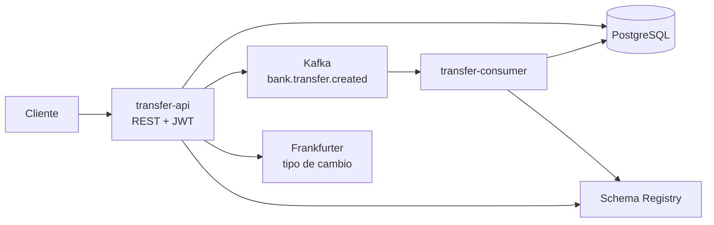

# Bank Transfer Quarkus

Aplicación local para registrar y procesar transferencias entre cuentas internas. El proyecto está compuesto por una API REST y un consumidor de eventos Kafka.

## Cómo funciona



1. `transfer-api` autentica al cliente y registra la transferencia como `PENDING`.
2. Publica un evento `TransferCreated` en Kafka.
3. `transfer-consumer` valida la transferencia.
4. Si es válida, descuenta la cuenta origen, acredita la cuenta destino y marca `COMPLETED`.
5. Si no es válida, marca `REJECTED` y guarda el motivo en el historial.

La creación de una transferencia responde `202` porque el procesamiento es
asíncrono. Después de crearla, consulta su estado hasta `COMPLETED` o
`REJECTED` antes de desactivar el beneficiario. Para el flujo demo, el número
de cuenta destino `002-000000099` debe existir en el seed local; un beneficiario
con una cuenta inexistente será rechazado por el consumer.

La explicación detallada del flujo de cada aplicación está en:

- [`transfer-api/README.md`](transfer-api/README.md): endpoints, autenticación y publicación del evento.
- [`transfer-consumer/README.md`](transfer-consumer/README.md): consumo, validaciones y actualización de saldos.
- [`contracts/avro/TransferCreated.avsc`](contracts/avro/TransferCreated.avsc): contrato del evento.

## Inicio rápido

Requisitos: Java 21, Podman, `podman compose`, `curl` y `python3`.

Desde esta carpeta:

```bash
cd infra-podman
cp .env.example .env
```

Edita `infra-podman/.env` y define valores locales para `POSTGRES_PASSWORD`, `DATABASE_PASSWORD`, `JWT_SECRET` y `DEMO_PASSWORD`. Las dos contraseñas de base de datos deben coincidir.

```bash
./scripts/check-secrets.sh
./scripts/start-all.sh
```

El arranque reutiliza las imágenes existentes. Después de cambiar el código o
un Dockerfile, reconstruye explícitamente las imágenes con:

```bash
REBUILD_IMAGES=true ./scripts/start-all.sh
```

La guía completa de infraestructura, variables, puertos y parada está en [`infra-podman/README.md`](infra-podman/README.md).

Servicios locales:

| Servicio | Dirección |
|---|---|
| API REST | `http://localhost:8081` |
| Consumer | `http://localhost:8082` |
| PostgreSQL | `localhost:15432` |
| Kafka | `localhost:19092` |
| Schema Registry | `http://localhost:8083` |
| AKHQ opcional | `http://localhost:9021` |

## Probar la API

El login público usa el correo del cliente demo y el valor configurado en `DEMO_PASSWORD`. Sustituye `secret` si elegiste otra contraseña:

```bash
curl -X POST http://localhost:8081/api/v1/auth/login \
  -H 'Content-Type: application/json' \
  -d '{"email":"demo@bank-transfer.local","password":"secret"}'
```

Después, usa el `accessToken` recibido como `Bearer token` en los endpoints protegidos. La colección de requests está en [`collection/api-collection`](collection/api-collection).

## Estructura

```text
bank-transfer-quarkus/
├── transfer-api/              # API REST y productor Kafka
├── transfer-consumer/         # Consumidor Kafka y procesamiento
├── infra-podman/              # PostgreSQL, Kafka, Schema Registry y AKHQ
├── contracts/avro/             # Contrato TransferCreated
└── collection/api-collection/  # Requests para probar la API
```

Los comandos para ejecutar módulos por separado, empaquetar y probar están documentados en los README de cada módulo. Este README contiene únicamente el mapa general y el punto de entrada del proyecto.
