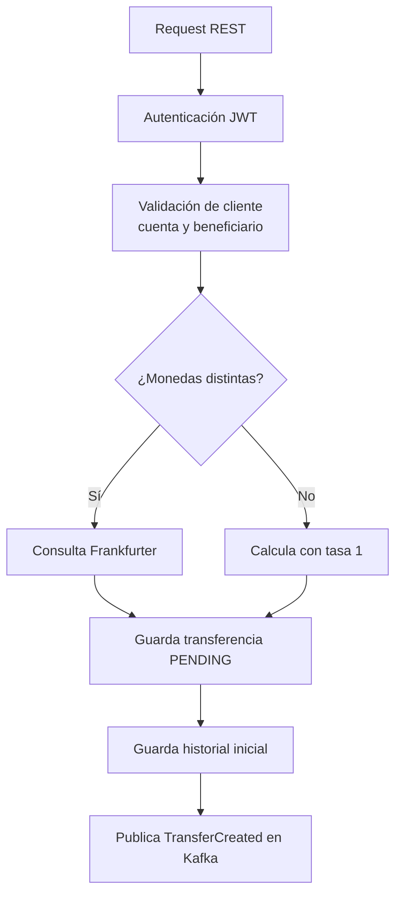

# transfer-api

Servicio Quarkus que expone la API REST, autentica clientes con JWT, registra transferencias y publica eventos Kafka.

## Responsabilidades



Al crear una transferencia, este módulo:

- Verifica que la cuenta origen pertenezca al cliente y esté activa.
- Verifica que el beneficiario pertenezca al cliente y esté activo.
- Consulta el tipo de cambio solo cuando la moneda origen y destino son diferentes.
- Guarda la transferencia y su historial inicial como `PENDING`.
- Publica el evento `TransferCreated` en el tópico configurado.

El débito y el crédito de saldos no se realizan aquí; esa responsabilidad pertenece a [`../transfer-consumer/README.md`](../transfer-consumer/README.md).

## API

Base local: `http://localhost:8081`.

| Método | Ruta | Acceso |
|---|---|---|
| `POST` | `/api/v1/auth/login` | Público |
| `GET` | `/api/v1/accounts` | Cliente autenticado |
| `GET`, `POST` | `/api/v1/beneficiaries` | Cliente autenticado |
| `GET`, `PUT`, `DELETE` | `/api/v1/beneficiaries/{id}` | Cliente autenticado |
| `POST`, `GET` | `/api/v1/transfers` | Cliente autenticado |
| `GET` | `/api/v1/transfers/{id}` | Cliente autenticado |
| `GET` | `/api/v1/transfers/{id}/history` | Cliente autenticado |
| `GET` | `/api/v1/admin/transfers` | Rol `ADMIN` |

Para ver cuerpos de requests y una secuencia de prueba, usa [`../collection/api-collection`](../collection/api-collection) y la guía general [`../README.md`](../README.md).

## Ejecutar en desarrollo

Primero inicia la infraestructura siguiendo [`../infra-podman/README.md`](../infra-podman/README.md). Luego, desde esta carpeta:

```bash
./mvnw quarkus:dev
```

La API usa el puerto `8081` mediante `TRANSFER_API_HTTP_PORT`. Las demás variables de conexión y seguridad se configuran en [`../infra-podman/.env.example`](../infra-podman/.env.example).

## Pruebas y empaquetado

```bash
./mvnw test
./mvnw package -DskipTests
java -jar target/quarkus-app/quarkus-run.jar
```

El módulo usa Java 21, Quarkus 3.40.1 y genera las clases Avro desde [`../contracts/avro/TransferCreated.avsc`](../contracts/avro/TransferCreated.avsc).
