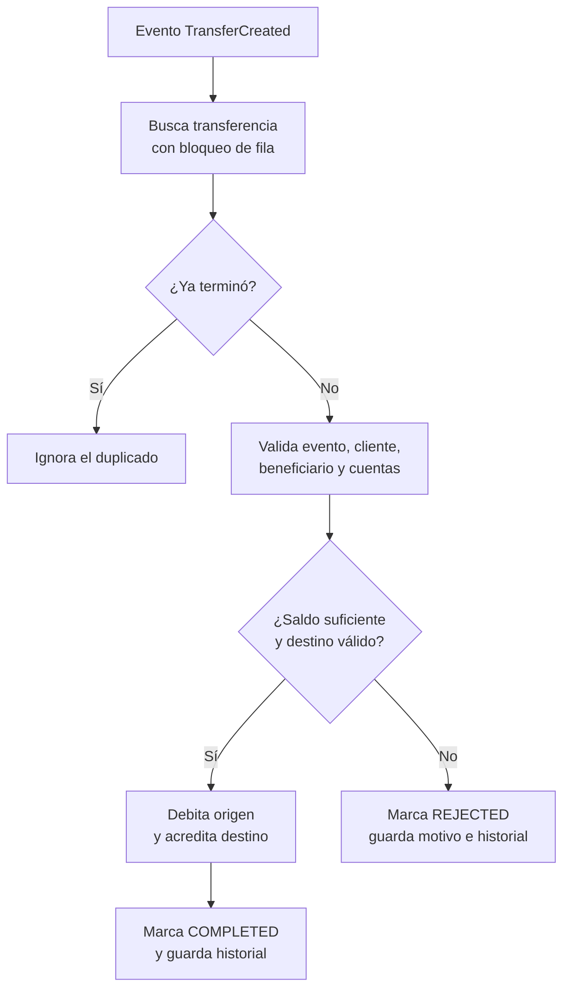

# transfer-consumer

Servicio Quarkus que escucha el evento `TransferCreated` de Kafka y procesa la transferencia contra PostgreSQL.

## Responsabilidades



El consumer:

- Lee el tópico `bank.transfer.created` con el grupo `transfer-consumer-group`.
- Valida que el evento corresponda a la transferencia guardada.
- Comprueba cliente, beneficiario, cuenta origen, moneda y cuenta destino.
- Trata el `accountNumber` del beneficiario como una cuenta interna de destino;
  debe existir, estar activa y tener la misma moneda declarada por el
  beneficiario. En el seed local, `002-000000099` es una cuenta USD válida para
  los ejemplos de la colección.
- Ejecuta débito y crédito dentro de una transacción.
- Rechaza por saldo insuficiente, cuentas inválidas o datos inconsistentes.
- Evita duplicar movimientos si Kafka entrega nuevamente un evento ya terminado.
- Reintenta cuando la transferencia todavía no es visible en PostgreSQL.

El contrato del mensaje está en [`../contracts/avro/TransferCreated.avsc`](../contracts/avro/TransferCreated.avsc). El productor que crea el mensaje está documentado en [`../transfer-api/README.md`](../transfer-api/README.md).

## Ejecutar en desarrollo

Primero inicia PostgreSQL, Kafka y Schema Registry siguiendo [`../infra-podman/README.md`](../infra-podman/README.md). Luego, desde esta carpeta:

```bash
./mvnw quarkus:dev
```

El consumer usa el grupo y el tópico configurados en [`../infra-podman/.env.example`](../infra-podman/.env.example). Cuando se ejecuta con Compose, queda publicado en `http://localhost:8082`; en `quarkus:dev` usa el puerto HTTP predeterminado `8080`. El procesamiento principal ocurre mediante Kafka.

## Pruebas y empaquetado

```bash
./mvnw test
./mvnw package -DskipTests
java -jar target/quarkus-app/quarkus-run.jar
```

El módulo usa Java 21, Quarkus 3.40.1 y genera las clases Avro a partir del contrato compartido.
